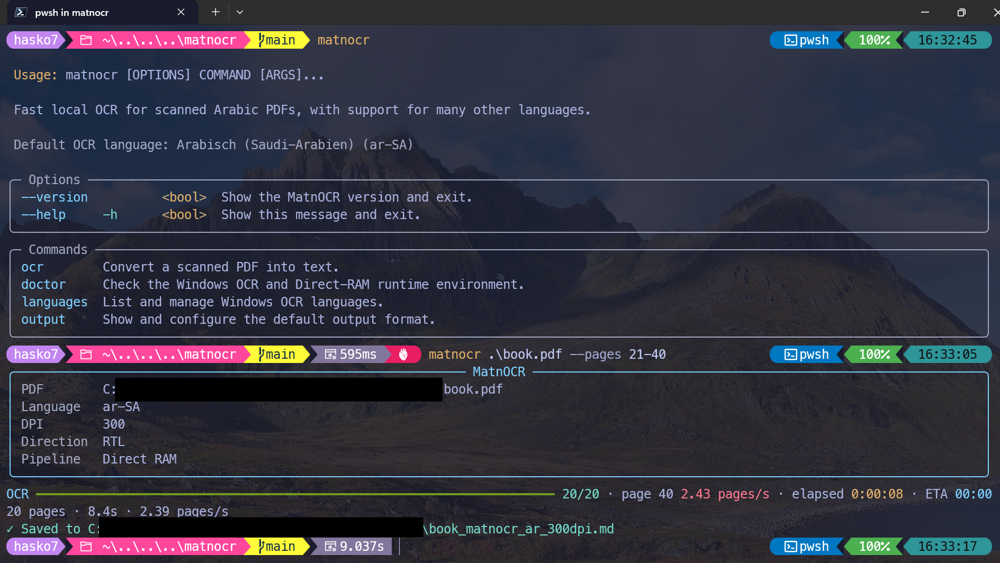
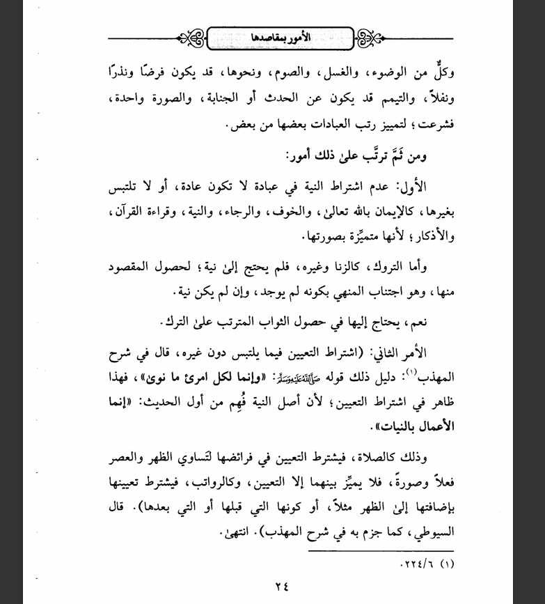

# MatnOCR

Fast, offline OCR for scanned PDFs on Windows. Built for Arabic books, with
support for the OCR languages installed on your system. No cloud service or GPU
required.

**Status:** Development preview. Install directly from GitHub today; PyPI
publishing and packaged Windows releases are planned.



## Features

- **Local processing:** native Windows OCR with PDF pixels kept in RAM.
- **Arabic and RTL:** word ordering reconstructed from detected positions.
- **TXT and Markdown:** UTF-8 exports, page markers, and a saved format preference.
- **Flexible input:** select pages, choose a quality preset, and switch languages.
- **Terminal-friendly:** progress, throughput, diagnostics, and a quiet mode.
- **Safe output:** existing exports are protected unless you pass `--force`.

## Installation

Requires Windows with `Windows.Media.Ocr` and an OCR language pack for your text.
Python 3.11–3.14 is tested in CI.

Install [uv](https://docs.astral.sh/uv/getting-started/installation/) and
[Git for Windows](https://git-scm.com/downloads/win), then open PowerShell:

```powershell
uv tool install --python 3.13 "git+https://github.com/Hasko7/matnocr.git"
matnocr doctor
```

uv downloads Python 3.13 if needed. No GitHub account or SSH setup is required.
If `matnocr` is not found, run `uv tool update-shell` and reopen PowerShell.

Alternatively, clone the repository and install locally:

```powershell
git clone https://github.com/Hasko7/matnocr.git
cd matnocr
uv tool install --python 3.13 .
```

See the [development guide](docs/development.md) for editable installation and
local checks.

## Quick Start

```powershell
# Show installed OCR languages
matnocr languages

# Install Arabic OCR if missing (Windows requests administrator approval)
matnocr languages install ar-SA

# Recognize an Arabic PDF
matnocr book.pdf --lang ar

# Export selected pages as Markdown
matnocr book.pdf --pages 9-10 -o notes.md
```

`matnocr ocr book.pdf` is also supported. Without options, MatnOCR uses the
saved language (initially Arabic), 300 DPI, and TXT output. The resulting file
is saved next to the PDF, for example `book_matnocr_ar_300dpi.txt`.

## Arabic OCR Example

An actual Arabic book page, followed by its unedited MatnOCR Markdown output.
The example includes the heading, body text, and footnote.



**Language:** `ar-SA` · **Resolution:** 300 DPI · **PDF page:** 21 (printed page 24).

Recognized output, including the original OCR errors:

```text
# Page 24

الأمور بمقاصدها


وكل من الوضوء، والغسل، والصوم، ونحوها، قد يكون فرضا ونذرا
ونفلا، والتيمم قد يكون عن الحدث أو الجنابة، والصورة واحدة،
فشرعت؛ لتمييز رتب العبادات بعضها من بعض.

ومن ثم ترتب على ذلك أمور:
الاول: عدم اشتراط النية في عبادة لا تكون عادة، أو لا تلتبس
بغيرها، كالإيمان بالله تعالى، والخوف، والرجاء، والنية، وقراءة القرآن ،
والاذكار؛ لانها متميزة بصورتها.

وأما التروك، كالزنا وغيره، فلم يحتج إلن نية؛ لحصول المقصود
منها ، وهو اجتناب المنهي بكونه لم يوجد، وإن لم يكن نية
نعم، يحتاج إليها في حصول الثواب المترتب على الترك.
الأمر الثافي: (اشتراط التعيين فيما يلتبس دون غيره، قال في شرح
المهذب"". دليل ذلك قوله تتهيلا: «وإنما لكل امرئ ما نول» ، فهذا
ظاهر في اشتراط التعيين؛ لأن أصل النية فهم من أول الحديث: «إنما
الأعمال بالنيات».

وذلك كالصلاة، فيشترط التعيين في فرائضها لتساوي الظهر والعصر
فعلا وصورة، فلا يميز بينهما إلا التعيين، وكالرواتب، فيشترط تعيينها
بإضافتها إلى الظهر مثلا، أو كونها التي قبلها أو التي بعدها). قال
السيوطي، كما جزم به في شرح المهذب). انتهىل.

٣) ٢٢٤/٦.
٢٤
```

Results vary with scan quality, typography, and layout. MatnOCR does not
automatically correct recognized words. See the [screenshot notes](docs/images/README.md)
for the image files used in this README.

## Common Options

| Task | Command |
| --- | --- |
| Choose pages | `matnocr book.pdf --pages 1,5,20-35` |
| Count PDF pages | `matnocr book.pdf --page-count` |
| Choose quality | `matnocr book.pdf --quality balanced` |
| Export Markdown | `matnocr book.pdf --format md` |
| Choose an output file | `matnocr book.pdf -o notes.md` |
| Save a default format | `matnocr output default md` |
| Show formats and examples | `matnocr output` |
| Ignore line and paragraph layout | `matnocr book.pdf --no-layout` |
| Suppress progress and summary | `matnocr book.pdf --quiet` |
| Replace an existing export | `matnocr book.pdf -o notes.md --force` |

Quality presets are `fast` (200 DPI), `balanced` (250 DPI), and `quality`
(300 DPI, the default). You can use `--dpi 200`, `250`, or `300` instead.

The `-o` extension selects the format: `.txt` for plain text, `.md` or
`.markdown` for Markdown. Without an explicit extension or `--format`, the
saved preference applies. Reset it with `matnocr output default txt`.
Markdown separates pages with headings such as `# Page 9`, using the original
PDF page numbers.

Full details: [usage guide](docs/usage.md) · `matnocr ocr --help`.

## Languages

MatnOCR supports **35 Windows OCR language variants**, including Arabic,
Chinese, English, German, Japanese, Korean, Russian, and Turkish. Install the
corresponding Windows OCR language pack to recognize text in that language.

| Code | Language |
| --- | --- |
| `ar-SA` | Arabic (Saudi Arabia) |
| `bg-BG` | Bulgarian |
| `bs-LATN-BA` | Bosnian (Latin) |
| `cs-CZ` | Czech |
| `da-DK` | Danish |
| `de-DE` | German (Germany) |
| `el-GR` | Greek |
| `en-GB` | English (United Kingdom) |
| `en-US` | English (United States) |
| `es-ES` | Spanish (Spain) |
| `es-MX` | Spanish (Mexico) |
| `fi-FI` | Finnish |
| `fr-CA` | French (Canada) |
| `fr-FR` | French (France) |
| `hr-HR` | Croatian (Croatia) |
| `hu-HU` | Hungarian |
| `it-IT` | Italian (Italy) |
| `ja-JP` | Japanese |
| `ko-KR` | Korean |
| `nb-NO` | Norwegian (Bokmål) |
| `nl-NL` | Dutch (Netherlands) |
| `pl-PL` | Polish |
| `pt-BR` | Portuguese (Brazil) |
| `pt-PT` | Portuguese (Portugal) |
| `ro-RO` | Romanian (Romania) |
| `ru-RU` | Russian |
| `sk-SK` | Slovak |
| `sl-SI` | Slovenian |
| `sr-CYRL-RS` | Serbian (Cyrillic, Serbia) |
| `sr-LATN-RS` | Serbian (Latin, Serbia) |
| `sv-SE` | Swedish (Sweden) |
| `tr-TR` | Turkish |
| `zh-CN` | Chinese (Simplified, Mainland China) |
| `zh-HK` | Chinese (Traditional, Hong Kong SAR) |
| `zh-TW` | Chinese (Traditional, Taiwan) |

The table reflects the Windows OCR capability catalog reported on the test
system. Actual availability and installation status are queried dynamically
on your own device. Automated OCR tests currently cover Arabic, German, and
English.

```powershell
matnocr languages
matnocr languages default ar-SA
matnocr languages available
matnocr languages install de-DE
```

Available languages are queried from Windows. Installing or removing OCR packs
requires administrator approval and may require a download; OCR itself runs
offline. See [language management](docs/usage.md#languages-and-windows-ocr-language-packs).

## Limitations

- Windows OCR and an appropriate language pack are required.
- There is no automatic spelling correction or Arabic normalization.
- Word ordering and paragraph spacing do not reconstruct complex columns,
  tables, or footnotes. Non-text detection is heuristic.
- Images above the Windows OCR size limit produce an error; automatic splitting
  is not available.
- PDF/JSON export, batch processing, resume support, and a GUI are not available yet.

Historical timings and their scope are documented in [benchmarks](docs/benchmarks.md).
They are not a performance guarantee for the current version.

## Roadmap

After the initial public release, planned additions include:

- **PDF export (v0.2):** a new PDF displaying the recognized text, and a searchable
  scan PDF preserving the original pages with an invisible OCR text layer.
- **Batch processing:** recognize multiple PDFs or folders.
- **Resume support:** continue interrupted book processing.
- **Structured output:** JSON and word bounding boxes.

## Contributing

Development uses uv, Ruff, ty, and pytest. Integration tests generate original
English, German, and Arabic documents locally, with language-dependent skips.

Start with the [contribution guidelines](CONTRIBUTING.md) and
[Code of Conduct](CODE_OF_CONDUCT.md). The [development guide](docs/development.md)
covers local setup and checks. Project architecture,
working rules, and the detailed task list are maintained in
[PROJECT.md](PROJECT.md), [AGENTS.md](AGENTS.md), and [TODO.md](TODO.md).

For vulnerabilities, follow the [security policy](SECURITY.md). Notable changes
are recorded in the [changelog](CHANGELOG.md).

## License

[Apache-2.0](LICENSE). Dependencies retain their own licenses; see
[third-party notices](THIRD_PARTY_NOTICES.md). Bundled Windows releases must
include the complete PDFium and third-party license files for their builds.
